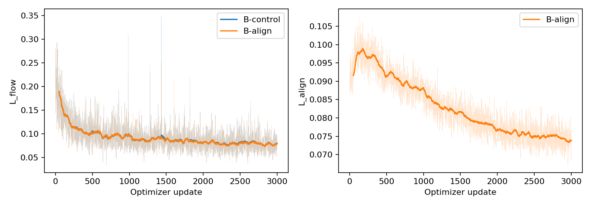
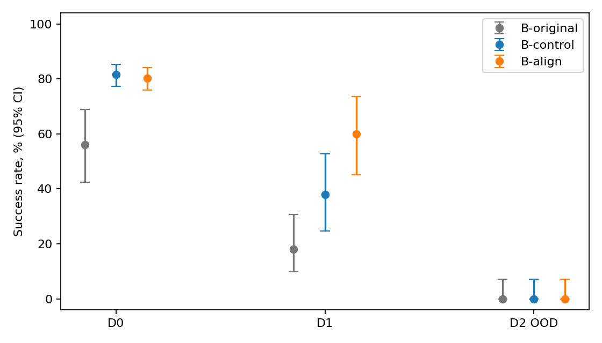

# Visual alignment π0 / LIBERO

Alignment на D2: результат статистически неопределён; улучшение не доказано; Δ=0.0 п.п., 95% CI [-8.4; 8.4]. D0: сохранение в пределах 2 п.п. не подтверждено; Δ=-1.4 п.п., односторонняя нижняя 95% с поправкой на два просмотра граница -7.5 п.п. Обе новые модели обучены на одинаковых D0+D1 из одной исходной π0; выбран заранее последний update 3001. D2 не участвовала в обучении, calibration, λ, normalization, debugging или выборе checkpoint.

| Task | B-original, reference | B-control | B-align | Δ, п.п. | paired 95% CI, п.п. | Статус |
|---|---:|---:|---:|---:|---|---|
|D0, n=500|56.0% (50)|81.6%|80.2%|-1.4|[-8.2; 5.4]|НЕОПРЕДЕЛЁН|
|D1, n=50|18.0% (50)|38.0%|60.0%|22.0|[-1.9; 42.0]|НЕОПРЕДЕЛЁН|
|D2, n=50|0.0% (50)|0.0%|0.0%|0.0|[-8.4; 8.4]|НЕОПРЕДЕЛЁН|

**Прямой ответ:** D2 — результат статистически неопределён; улучшение не доказано. D0 — сохранение в пределах 2 п.п. не подтверждено. Статистически неопределённые результаты не объявляем успехом.
B-original — исторический reference из pinned source, а не causal control. D0 критерий: нижняя граница строго>−2 п.п.; D2: нижняя paired 95% CI строго>0. D1 показана как exploratory superiority.

Обучены новые B-control и B-align: LoRA32 в PaliGemma/action expert плюс параметры, которые upstream low-memory recipe оставляет trainable (включая SigLIP). Отличие arms — frozen-projector cosine regularizer. Перенесены frozen C-RADIO, middle backbone patch alignment и предварительно обученный LN+MLP с последующим замораживанием. Адаптации: flow matching вместо CE, девятый блок PaliGemma, 2 камеры, bilinear 14×14 → 16×16. Middle state вычисляется prefix-only первыми 9 блоками; Интеграционная проверка π0 измерила relative RMSE 0,00396 при заранее заданном BF16 допуске 0,005 ([лог](logs/model_integration.json)); все слои не материализуются.

Конфигурация: seed обучения 0, 3001 обновление, effective batch 8; microbatch 8, accumulation 1, OOM событий 0. AdamW: β₁=0,9, β₂=0,95, clip=1; cosine schedule, warmup 1000, peak LR 2,5·10⁻⁵, decay 30000, min LR 2,5·10⁻⁶; [полный конфиг](configs/B-align.json). λ=0.2. Projector: 200 updates; pilot: 20 updates; K=4. Демонстрации: 50 D0 + 50 D1; 11745 кадров. Нормализация all-seen, chunk-weighted, next-action shift; отличается от исторического pipeline обработкой последнего неполного batch, это зафиксированная адаптация.

Evaluation: 1200 новых эпизодов. D0 — 500 пар, seeds 10000–10499; D1/D2 — по 50 пар, seeds 10000–10049. Reset states и общий префикс flow-noise совпадают внутри каждой пары.

| Run | Длительность процесса, ч | NVML peak, GiB | JAX allocations peak, GiB | JAX pool peak, GiB |
|---|---:|---:|---:|---:|
|B-control|0.97|недоступен (PID namespace)|20.39|32.00|
|B-align|1.32|32.48 (частичное окно)|25.30|32.00|

GPU: фактически A100-SXM4-80GB. Blackwell smoke не проверен на этой машине. Driver 580.159.03; JAX 0.5.3, CUDA runtime 12.8. Фактическая ставка аренды: $1.185/час ([billing log](logs/cost_rate.json)); от первого compatibility smoke до финального evaluation: 6.03 ч, примерно $7.15. Это оплачиваемое walltime инстанса, включая ожидание/подготовку между стадиями; начальный setup и публикация исключены.

L_align показана для B-align; в B-control этот loss не вычисляется. Интервалы SR на графике: exact CP; D0 с поправкой на два предусмотренных просмотра, D1/D2 fixed-cohort95%; исторический reference использует исходные Wilson95%.



Проблемы: NVML host PID отличается от PID контейнера; первоначальная per-process серия возвращала ложные нули и признана недоступной. JAX allocations/pool peaks измерены за весь процесс; B-align NVML probe подключён после первых updates и помечен как частичное окно, не полный peak всего run. CUDA 12.6 обновлена до 12.8; локальный HF dynamic loader и per-tensor loading RADIO несовместимы с выбранным Transformers, использована прямая загрузка полного pinned safetensors state_dict с strict=True. При первом D0 rollout отсутствовал system ffmpeg: видео валидировано после установки, эпизод сохранён; JSON tuple/list сравнение resume исправлено с сохранением строгой проверки binding ([лог](logs/evaluation_dependency_recovery.json)). Доверительные границы — консервативные exact CP с marginal Bonferroni. D0: односторонний критерий и двухсторонний CI учитывают 2 заранее заданных просмотра; D1/D2: fixed50. При n=50 интервал может быть широким. D0: фактически 500 пар; расширение до 500 выполнено по заранее записанному правилу. Один seed обучения ограничивает перенос вывода на другие seeds.

Первые 50 пар по всем задачам: [архив результатов](evaluation/first50/results.json), [CSV](evaluation/first50/summary.csv). Все числа: [paired results](evaluation/results.json), [CSV](evaluation/summary.csv), [logs](logs/), [pins](configs/pins.json), [дизайн](docs/DESIGN_RU.md). Исторический reference: [pinned table](https://github.com/qrvmil/maniskill_myws/blob/c6b77f51e3e5bd8873b812d258744c43380fdfeb/docs/multitask_sft/success_rates.csv). [Статья](https://arxiv.org/html/2510.25616).

Воспроизведение (полные команды и environment lock в README):
```bash
python scripts/prepare_reproduction.py
bash scripts/setup.sh
source scripts/env.sh
$ALIGN_PY -m pytest -q
$ALIGN_PY -m alignment.smoke
$ALIGN_PY scripts/fetch.py
$ALIGN_PY -m alignment.build_cache --samples 2
$ALIGN_PY -m alignment.train smoke
$ALIGN_PY -u scripts/run_pipeline.py
```
